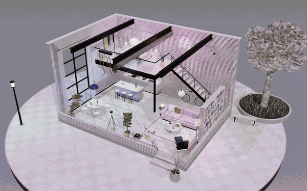

# Wutong Lane Loft

A small 3D loft you can spin around 360°: an old factory on Wutong Lane turned into a home, with 5.4 m ceilings, a mezzanine bedroom and three lynx-point Siamese cats.

## What's inside

- **Three styles**, switchable from the panel and remembered per browser:
  - **Minimal**: white-painted brick, microcement floor, black steel and black-and-white photos
  - **Warm Vintage**: red brick, honey wood floor, a sage-green kitchen and cognac leather
  - **City Neon**: pink brick, terrazzo, mint and lilac, neon signs and a blossom tree outside
- **English and Chinese**: a language switch in the top-right corner changes every label and caption
- **Three times of day**: morning, dusk and night, each with its own sky and lighting
- **Six views**: overview, living room, bedroom, kitchen, stairs and the photo wall
- **Small things that move**: the cats breathe, the kitten bats a tennis ball, leaves fall outside, and the record spins while music plays
- **Background music**: an original city-pop loop synthesized live in the browser with the Web Audio API (electric piano, bass, drums, pad, a short lead line, tape wobble and vinyl crackle). Press **Music** to start it.

## Sharing a demo in one language

Add `#en` or `#zh` to the link. `index.html#en` always opens in English and `index.html#zh` in Chinese. Without either, the page uses the viewer's last choice, then their browser language. Switching languages on the page updates the link, so you can copy it from the address bar.

## Run it

Open `index.html` in a browser. It is a single self-contained page; the only external pieces are three.js r128 and OrbitControls from jsDelivr, plus Google Fonts.

To publish it, turn on GitHub Pages for this repository (Settings → Pages → deploy from the `main` branch, root folder).

## Controls

Drag to rotate, scroll or pinch to zoom, right-drag to pan. Auto-rotate pauses while you interact and resumes a few seconds later.
