# Wutong Lane Loft

**[Open the live demo](https://loooongmango.github.io/wutongli-loft/)** (English: [`#en`](https://loooongmango.github.io/wutongli-loft/#en), Chinese: [`#zh`](https://loooongmango.github.io/wutongli-loft/#zh))

A small 3D loft you can spin around 360°: an old factory on Wutong Lane turned into a home, with 5.4 m ceilings, a mezzanine bedroom and three lynx-point Siamese cats.

## Three styles

The same loft, restyled from the panel. Every material, light, sky and caption changes with it.

<table>
  <tr>
    <td width="33%">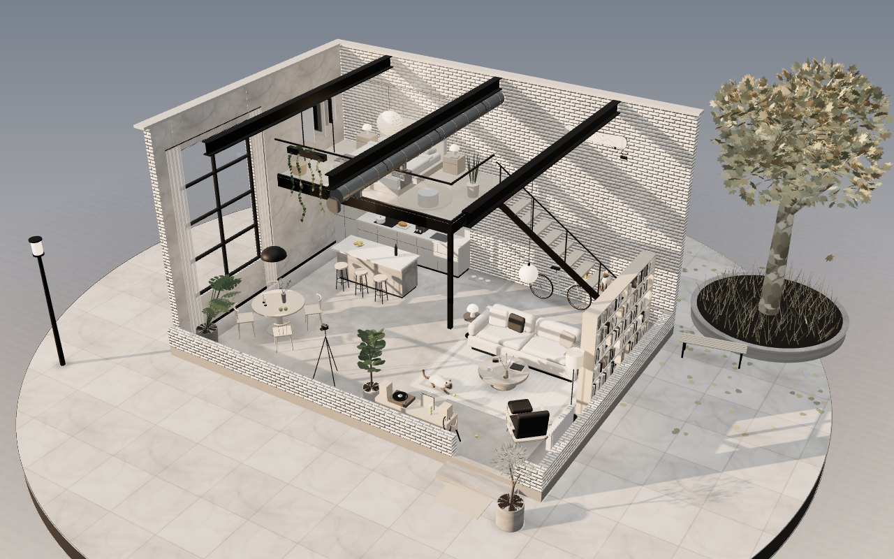</td>
    <td width="33%">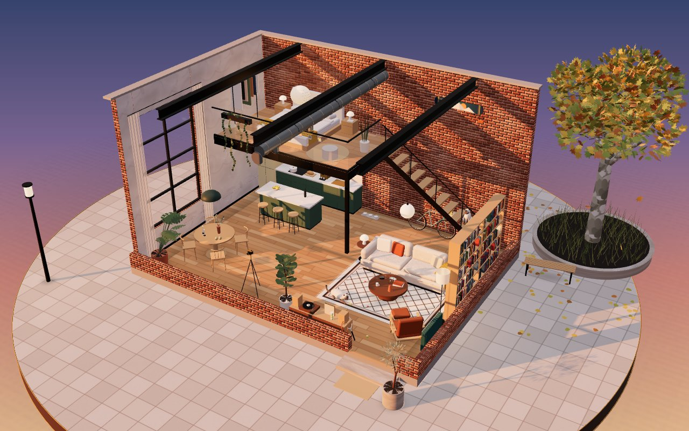</td>
    <td width="33%">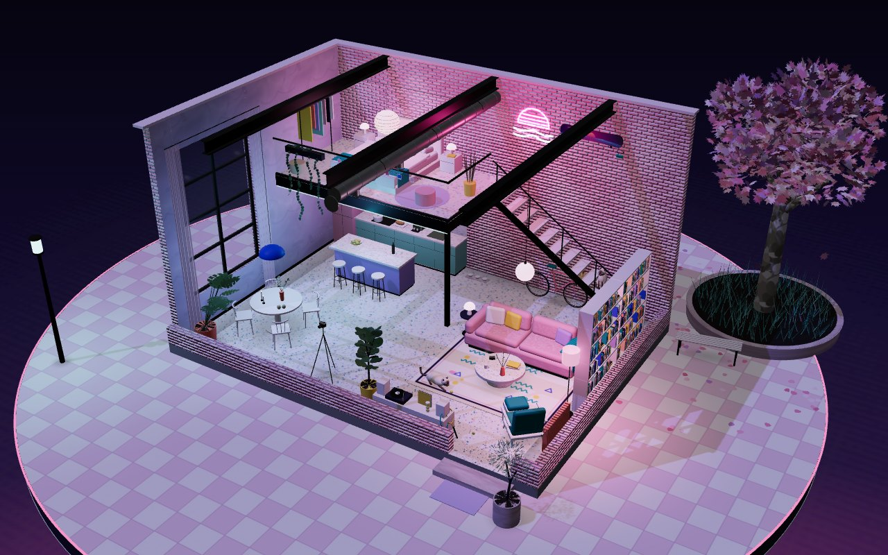</td>
  </tr>
  <tr>
    <td><b>Minimal</b> White-painted brick, microcement floor, black steel, black-and-white photos</td>
    <td><b>Warm Vintage</b> Red brick, honey wood floor, a sage-green kitchen, cognac leather</td>
    <td><b>City Neon</b> Pink brick, terrazzo, mint and lilac, neon signs, a blossom tree outside</td>
  </tr>
</table>

## Details

<table>
  <tr>
    <td width="50%">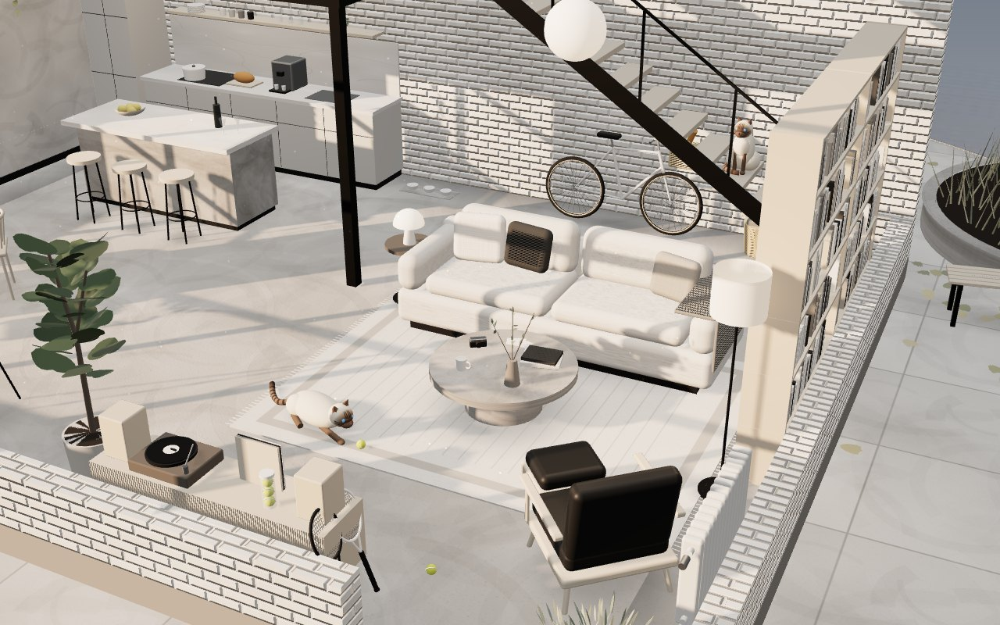</td>
    <td width="50%">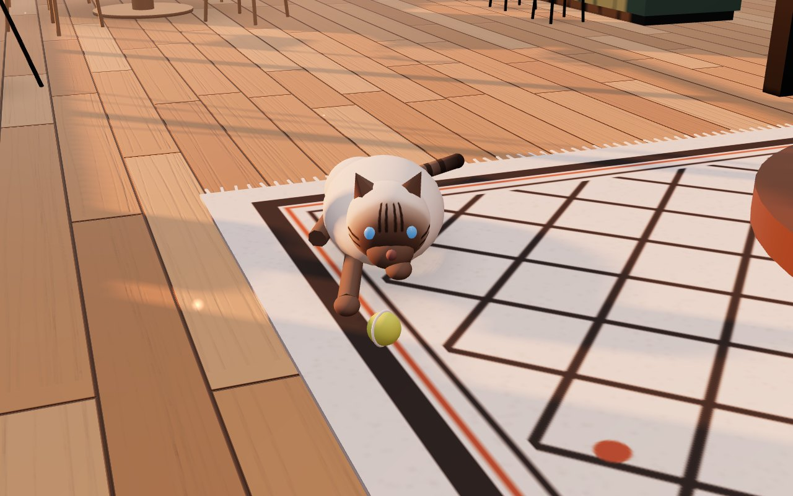</td>
  </tr>
  <tr>
    <td><b>Living room</b> · Minimal, dusk Low boucle sofa, concrete drum table, a record console with a tube of tennis balls and two rackets leaning on it</td>
    <td><b>The kitten</b> · Warm Vintage, dusk Lies on the rug with a paw on a tennis ball. Its tail flicks and it bats the ball every few seconds</td>
  </tr>
  <tr>
    <td>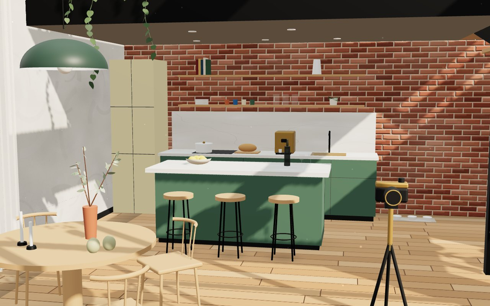</td>
    <td>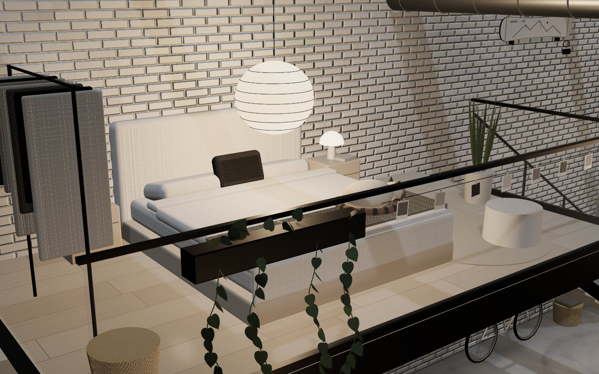</td>
  </tr>
  <tr>
    <td><b>Kitchen</b> · Warm Vintage, morning Sage cabinets and island, stone counters, open shelves, an espresso machine and three cat bowls by the wall</td>
    <td><b>Mezzanine bedroom</b> · Minimal, night Paper lantern, linen bedding, the big cat asleep at the foot of the bed, Polaroids clipped to the railing</td>
  </tr>
  <tr>
    <td>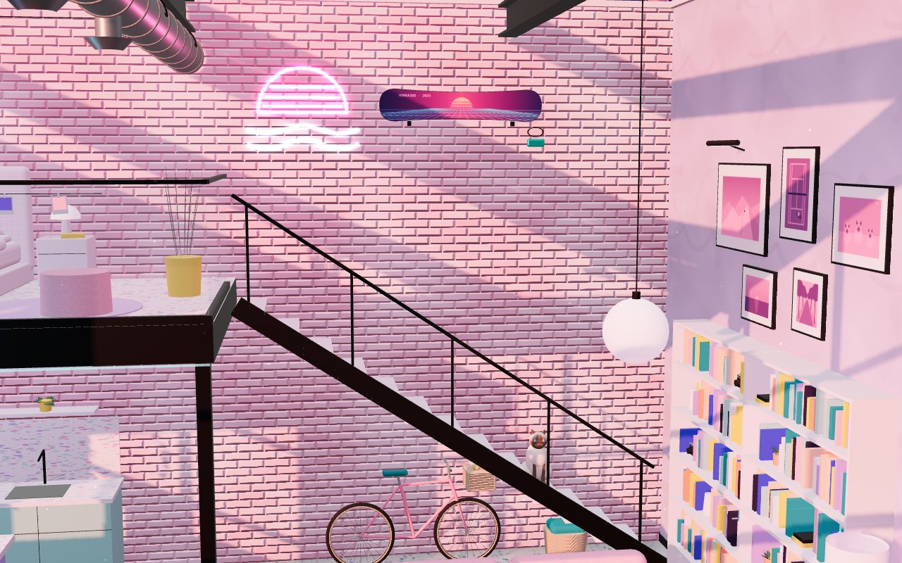</td>
    <td>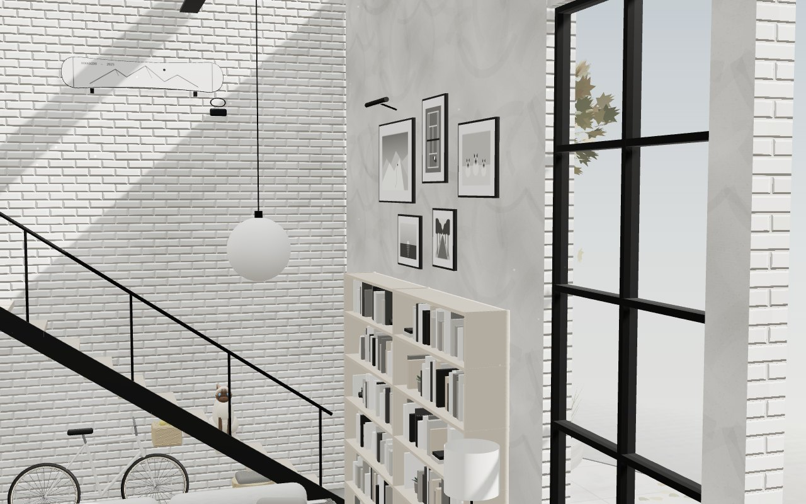</td>
  </tr>
  <tr>
    <td><b>Stairs</b> · City Neon, dusk Floating treads, the snowboard on the wall, a neon sunset sign, the bike parked below and a cat on the fourth step</td>
    <td><b>Photo wall</b> · Minimal, morning Prints of snowy mountains, a clay court and the three cats, in black and white here and in color or duotone in the other styles</td>
  </tr>
  <tr>
    <td>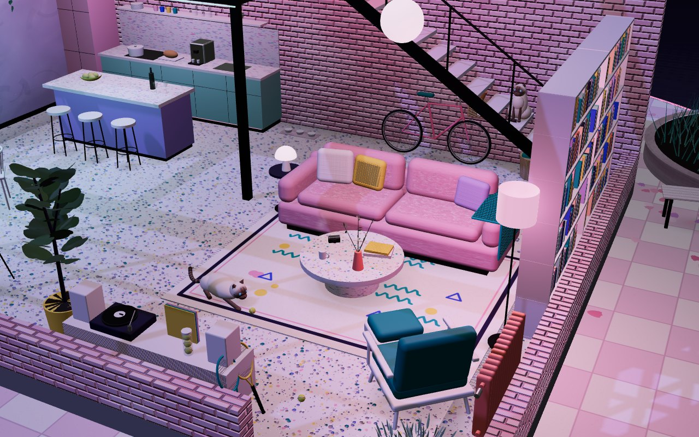</td>
    <td>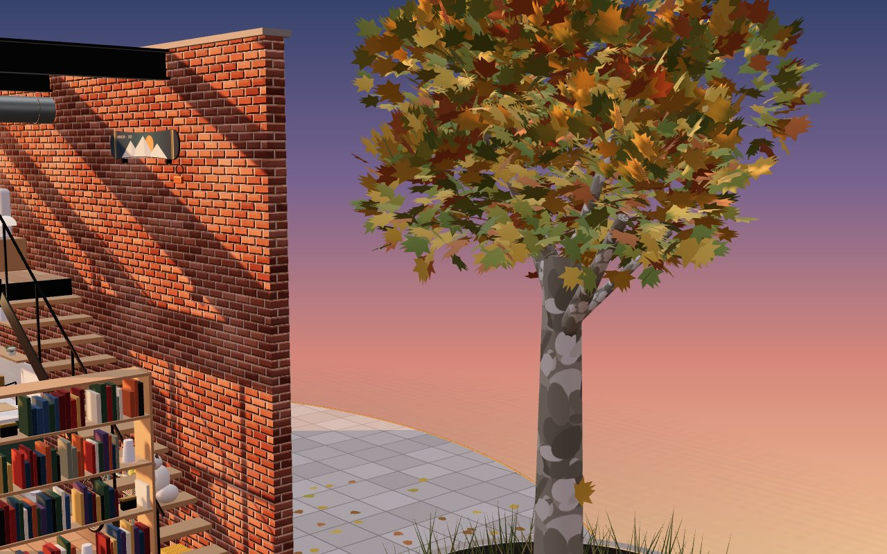</td>
  </tr>
  <tr>
    <td><b>Living room</b> · City Neon, night Pink velvet sofa, terrazzo floor, a teal velvet chair and a patterned rug under pink and blue light</td>
    <td><b>Outside</b> · Warm Vintage, dusk A plane tree in a stone planter with grasses and a bench. Leaves drift down onto the paving</td>
  </tr>
</table>

## Controls

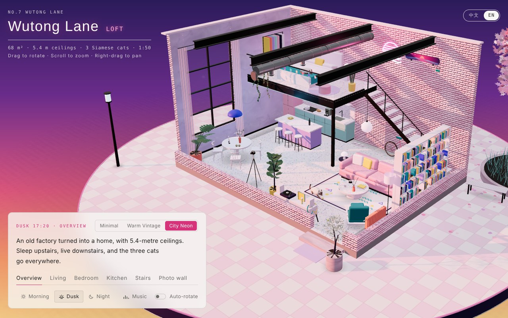

The panel switches style, view and time of day, starts the music and toggles auto-rotate. The language switch sits in the top-right corner.

## What's inside

- **Three styles**: Minimal, Warm Vintage and City Neon, remembered per browser
- **English and Chinese**: every label and caption, plus the name plate on the base
- **Three times of day**: morning, dusk and night, each with its own sky and lighting
- **Six views**: overview, living room, bedroom, kitchen, stairs and the photo wall
- **Small things that move**: the cats breathe, the kitten bats a tennis ball, leaves fall outside, and the record spins while music plays
- **Background music**: an original city-pop loop synthesized live in the browser with the Web Audio API (electric piano, bass, drums, pad, a short lead line, tape wobble and vinyl crackle). Press **Music** to start it.

## Sharing a demo in one language

Add `#en` or `#zh` to the link. `#en` always opens in English and `#zh` in Chinese. Without either, the page uses the viewer's last choice, then their browser language. Switching languages on the page updates the link, so you can copy it from the address bar.

## Run it locally

Open `index.html` in a browser. It is a single self-contained page; the only external pieces are three.js r128 and OrbitControls from jsDelivr, plus Google Fonts. The live demo is served by GitHub Pages from the `main` branch.

Drag to rotate, scroll or pinch to zoom, right-drag to pan. Auto-rotate pauses while you interact and resumes a few seconds later.
